# Black 2006 Recomp

An experimental Windows recompilation of the original Xbox release of
**BLACK (2006)**, built with XboxRecomp. It includes a Direct3D 11 renderer,
keyboard and mouse controls, XInput controller support, video settings, a PC
launcher, and native audio output. Movies are enabled by default. The Windows
build can also run on x86_64 Linux through Wine/Proton; see [Linux setup](docs/linux.md).

## The launcher

**BLACK Launcher** sets the game up and starts it. It is written in C++ on [Walnut](https://github.com/StudioCherno/Walnut)
and drawn like the game's own menu pages, with the game's menu fonts once your disc is in place.

- **Your disc**: choose an ISO (XISO or a full Redump dump) or a folder of extracted files, or drop it onto the
  window. The launcher checks it is the supported release, then copies it into `game/` with progress; a stopped
  copy carries on where it left off.
- **Build the game** turns your disc into the PC game. It looks for the tools that needs (Visual Studio's C++
  tools, CMake, Python and Rust), installs the missing ones with winget when you ask, then runs each step with
  its progress: preparing the tools, translating the code from your disc, setting up the build, compiling and
  making the menu languages. A stopped build carries on where it left off, a failed one shows the step and its
  output, and everything is logged in `reports/build-<date and time>.log`.
- **Play** starts the game and keeps its output in `reports/launcher-<date and time>/`. While it runs, the same row
  stops it. `BLACK Launcher --play` starts it with no window, for shortcuts.
- **Settings**: display, graphics, controls with key bindings read by key position (as the game stores them),
  game options and the menu language, and diagnostics. Changes are saved at once to `local/video.ini`,
  `local/controls.ini` and `local/xbox-launcher.json`, which the game's own settings pages also edit.
  **Diagnostics** turns on the detailed traces and prepares a GitHub issue about the last game run, without your
  folder names, for you to check and send.
- **Save game**: rename a profile slot, open or lock missions and set their results, or unlock them all. Every save
  backs the profile up first (`local/profile-backups/`), and any backup can be put back.
- It speaks the six menu languages (Settings > Game > Menu language).

See [launcher/README.md](launcher/README.md) to build or change it.

| Main menu | Your disc |
| --- | --- |
| 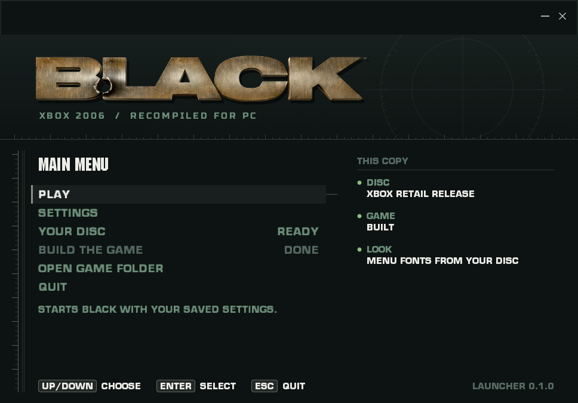 | 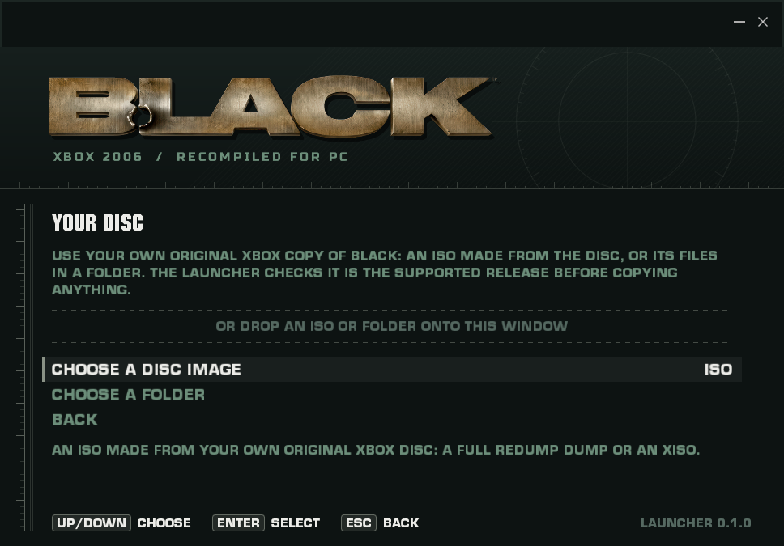 |
| **Checking the disc** | **Copying** |
| 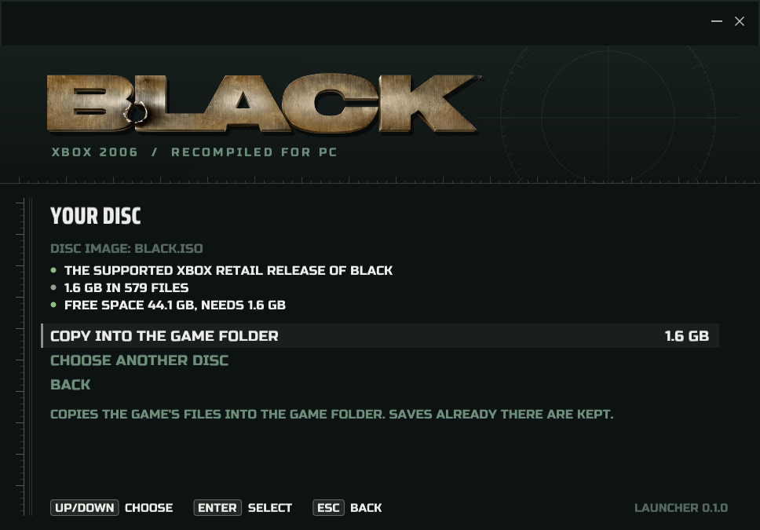 | 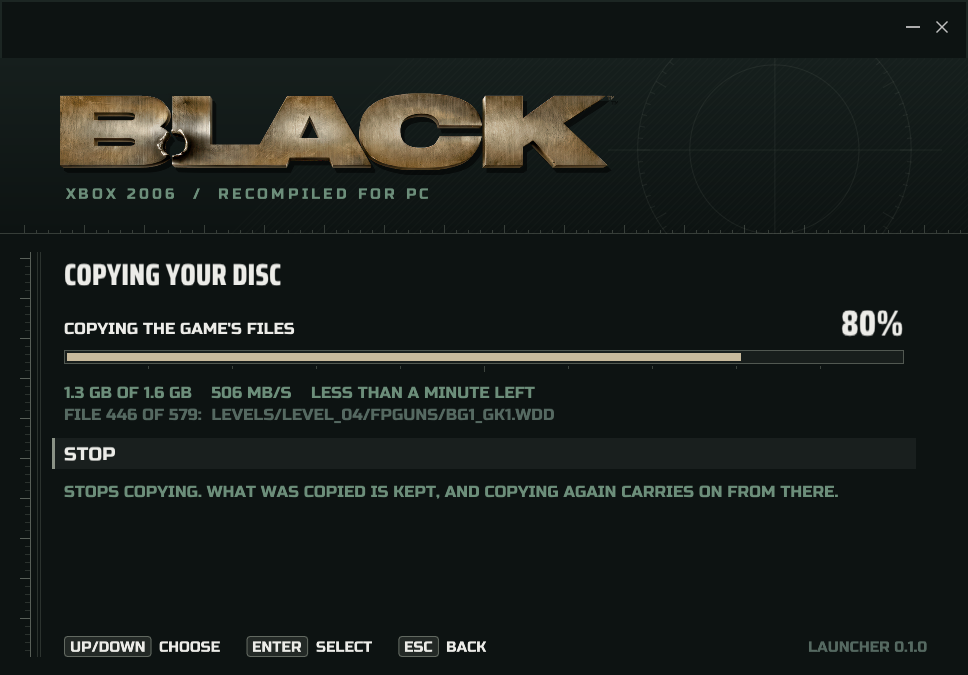 |
| **Settings** | **Key bindings** |
| 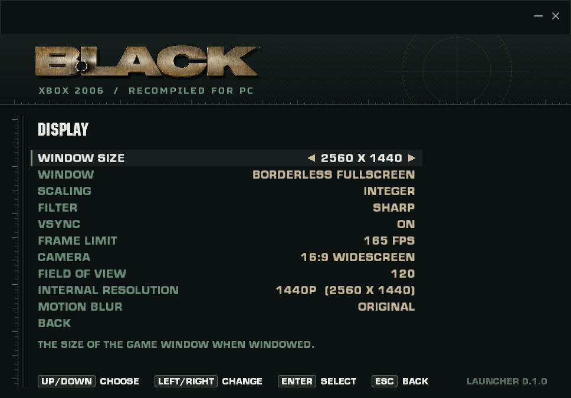 | 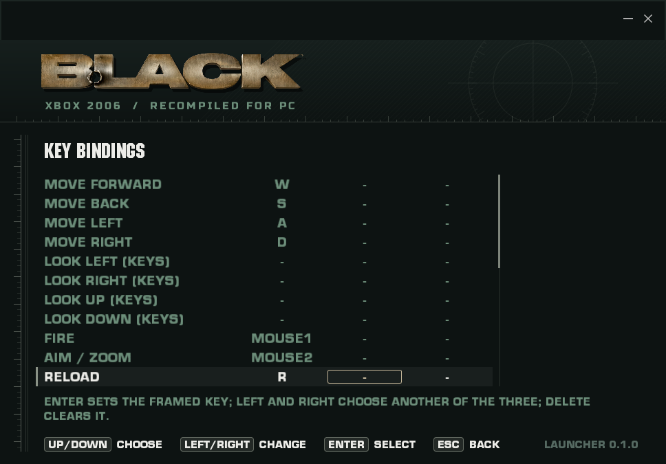 |
| **Save game** | **In Portuguese** |
| 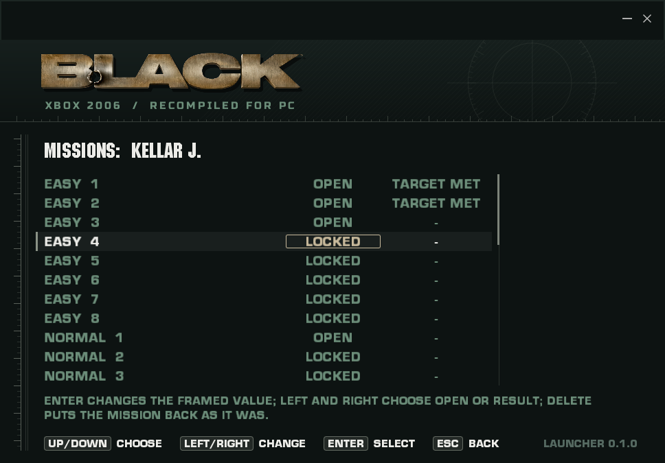 | 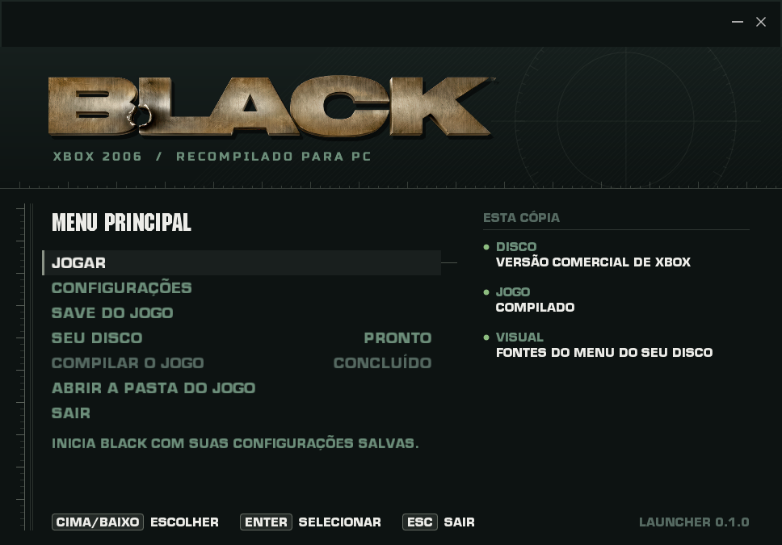 |

## HD textures

The game can use [BLACK HD Reimagined](#credits-and-licensing), a texture pack made by HD REIMAGINED for the PS2
version in PCSX2. It is not included here.

To install it:

1. Download the pack from ModDB:
   [BLACK HD Reimagined Texture Pack](https://www.moddb.com/mods/black-hd-reimagined/addons/black-hd-reimagined-texture-pack).
2. Make a folder named `texture_pack_hd` next to `BLACK Launcher.exe`.
3. Extract the download into it. Any layout of subfolders works: the PCSX2 one
   (`texture_pack_hd/SLUS-21376/replacements/...`) is fine as it is.
4. In the launcher, choose **Settings > Game > Textures: HD PACK**, then **Play**. **ORIGINAL** goes back to the
   game's own textures.

The pack's files are named by PS2 hashes that mean nothing to the Xbox version. Instead,
[`textures/black-hd-reimagined.map`](textures/black-hd-reimagined.map) says which pack file replaces which game
texture. It was made by matching every texture on the disc (about 2000) to the pack by look, then checking the pairs by
eye: 1161 game textures use 1007 of the pack's 1324 files. The rest are versions of the same picture or have no
counterpart in this version. Without the map, the game falls back to matching by look while it plays, keeping what it
learned in `texture_pack_hd/black_recomp_index.bin`.

| Original | HD pack |
| --- | --- |
| 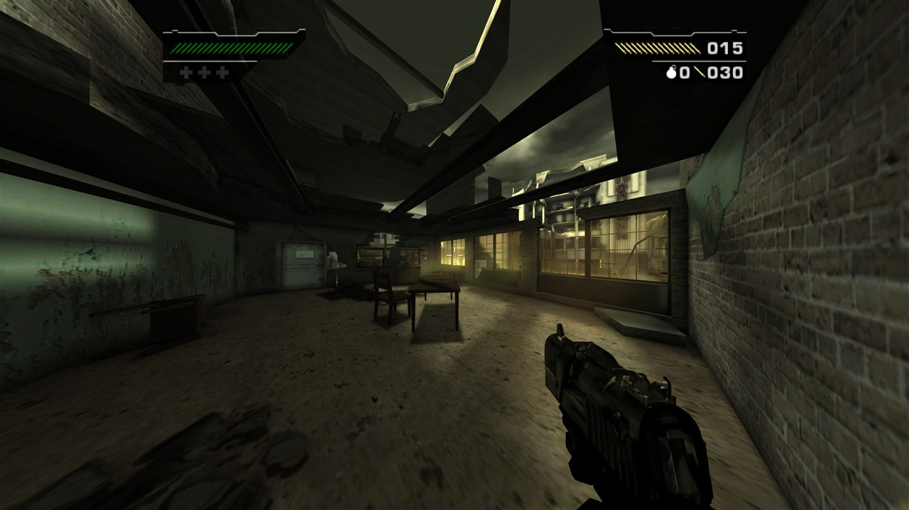 | 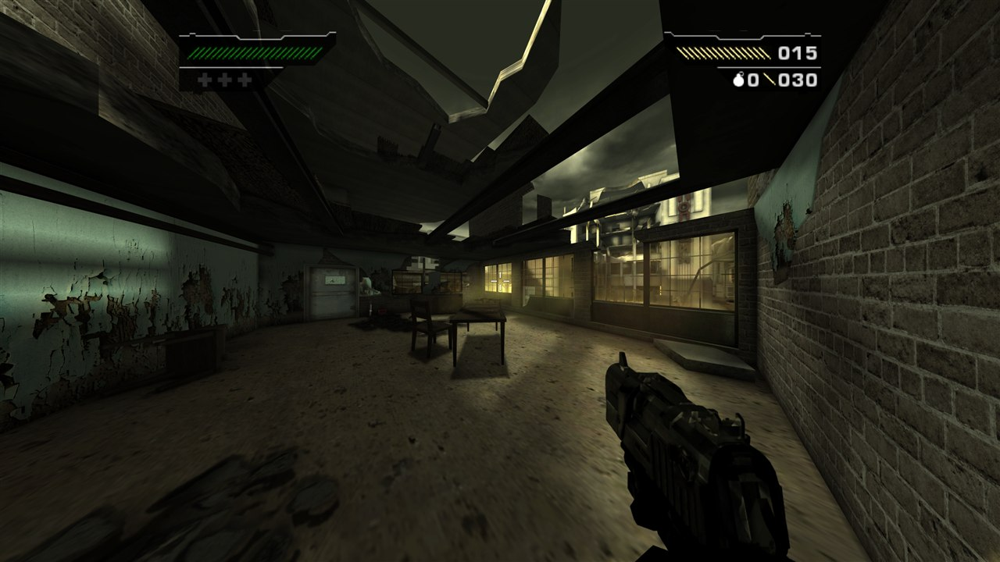 |
| 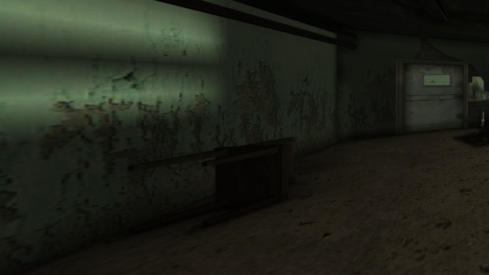 | 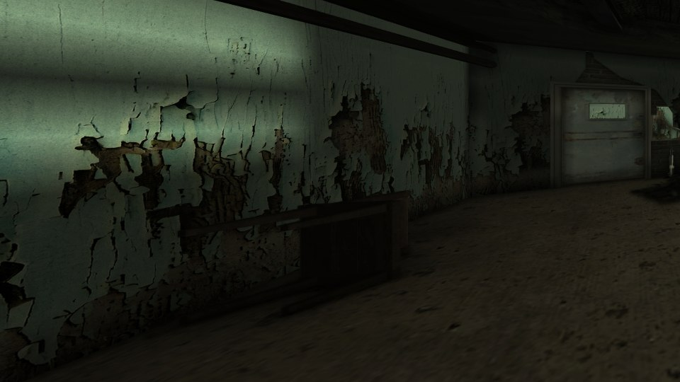 |

## Release archives

The starter release includes **BLACK Launcher** built for Windows (`BLACK Launcher.exe`) and for Linux. Open it,
choose your disc, then **Build the game**: it installs what it needs and builds. After that, **Play** starts the
game. Nothing else needs to be run.

Linux can generate and compile the complete game without a Windows installation; the launcher runs natively and
starts the game through Wine/Proton. See [Linux build and setup](docs/linux.md). **Play BLACK.sh** and
**BLACK Settings.sh** open the launcher; **Install Linux Shortcuts.sh** creates clickable desktop entries.
The public starter contains host source and the compiled launcher; game executables, generated game code,
retail files, language banks, settings and saves are excluded.

The launcher finds the game at a portable `bin/black_xbox_recomp.exe` or in the
`build-vs2022/Release/` layout. Keep `black-release.json` beside the launcher. Archive and file SHA-256
checksums are included.

Startup logos skip on one press of Escape, Enter, Space, left click, or controller
A / B / Start. During a cutscene, the first press shows **Press again to skip**
in the bottom-right corner. Release and press again within three seconds to skip;
holding a button cannot confirm. The hint also works with native menus disabled
and stays at the window corner on ultrawide displays. Looping menu backgrounds
keep playing normally. See the [movie skip tests](tests/movie_skip/README.md).

The added **Crosshair** and **Hit Markers** are independent options in the launcher's
**Settings > Gameplay** and the in-game **Options > Gameplay Settings** page,
including while paused. Both default to **Off**. Crosshair Off keeps BLACK's
original aiming dot; enabling it offers Cross, T-shape and Circle styles. Choices
are saved in `local/video.ini`; existing saved preferences are preserved.

Ambient occlusion adds contact shading from scene depth with **SSAO Classic,
HBAO, HBAO+, and GTAO**, each with Low, Medium, High, and Ultra quality. Choose
the method and quality in the launcher's **Settings > Graphics** or the in-game
**Video Settings > Graphics** page. AO defaults to **Off**, with **High** quality
selected for when it is enabled. The launcher's labels and help follow the
selected menu language. The in-game **Video Settings > Graphics** page also
localizes its tabs, setting names, values, and help text between English and
Brazilian Portuguese.

These are local implementations of the techniques; HBAO+ does not use the
vendor SDK. The [AO regression tests](tests/ambient_occlusion/README.md) exercise
the actual shaders, settings and native camera hook without game files.

**Reflections** replaces BLACK's 128 x 128 environment maps (weapons, windows,
glass) with screen-space reflections of the scene. Choose Original, Low, Medium,
High (default) or Ultra in the launcher's **Settings > Graphics** or the in-game
**Video Settings > Graphics** page. Original keeps the game's maps. See
[docs/reflections.md](docs/reflections.md).

AO reconstructs positions at the sampled depth texel and retries when an early
draw has no usable depth buffer. Autofocus selects a representative surface in
the central aperture, reducing focus jumps from thin foreground objects.
After a gap without usable scene depth, autofocus reacquires the current view
instead of blending from an old foreground focus distance.
Wider gameplay FOV preserves the native framing of the player's weapon, arms,
and suppressor using their render-queue ownership. World and companion weapons
retain their own projection; see the [viewmodel tests](tests/viewmodel/README.md).
Ultrawide sniper scopes extend the original outer black masks to the screen
edges while preserving the aperture and reticle. The [scope mask tests](tests/scope_mask/README.md)
cover native resource ownership, aspect ratios and temporary draw-state restoration.

Enemy weapon-model lookup now preserves carry in the original 64-bit name
calculation. Corrupted model names previously left enemies without a weapon
model and prevented their native death-drop code from creating pickups. The
[weapon model regressions](tests/weapon_model_math/README.md) cover the arithmetic
and save-hash compatibility; native drop rules remain in control.

Launch through the first mission has been tested, including the opening movies,
mission briefing, movement, shooting, and reloading with audio. This is still a
work in progress: selected cemetery and docks scenes have also been checked,
but complete later-mission playthroughs remain unverified. Crashes and rendering issues
remain possible, and Xbox GP/EP audio effects are not fully emulated.

Gameplay voices and effects now honor their source sample rate at the 48 kHz
audio output. This corrects 32 kHz speech playing about 50% too fast and high.
The [APU regression test](tests/apu_pitch/README.md) checks pitch, duration,
stream completion, and playback lifecycle without game files or an audio device.

The fallback mixer preserves dry left/right and 3D speaker assignments without
playing raw effect sends a second time. This avoids reversed duplicate channels
and the clipping they caused. Native DSP output still takes precedence; see the
[spatial audio regressions](tests/apu_spatial/README.md). To export speech or
music from your own Xbox SSH/BKS banks, use the [audio extraction guide](docs/audio-extraction.md).

Audio pacing retains fractional frame time and recovers ordinary scheduling
delays. The Windows output queues two packets before starting playback to provide
scheduling headroom, and restores that buffering after an underrun. The [timing](tests/apu_timing/README.md) and
[output queue](tests/apu_output/README.md) regressions cover these paths without
an audio device. A reported critical device error recreates the output on its
submission thread and primes fresh samples; failed retries are limited to once
per second. Set `RECOMP_APU_TRACE_OUTPUT=1` for five-second source, clipping,
queue, playback and recovery counters when investigating an audio problem.

BLACK also routes its primary stereo audio through custom DSP bins 19/20.
The dry fallback includes that explicit pair when native EP PCM is unavailable,
restoring soundtracks and level sounds that have no standard speaker send.
Other effect sends stay excluded to avoid duplicated or reversed dry audio.
The [spatial regression](tests/apu_spatial/README.md) checks channel direction,
auxiliary sends, and native PCM ownership.

The APU also receives the size of the runtime's actual physical mappings,
including the second view of low guest RAM when it is present. This lets GP/EP
bootstrap and DMA reach valid audio pages above the 64 MB contiguous arena
while retaining bounds checks for unmapped memory. The [physical backing
regression](tests/apu_physical_memory/README.md) covers both DSPs and their
scratch/FIFO transfers. Cutscene soundtracks use the same guest audio pipeline;
they are stored separately from the native XMV video files.

This repository contains host source and build tooling. **You must supply your
own original Xbox game files.** Game assets, the XBE, generated game-function
bodies, recordings, and prebuilt game executables are excluded. Release archives
include the compiled launcher, which contains no game code.

## Build

For a build entirely on Linux, follow [the Linux guide](docs/linux.md) and run
`bash './Build BLACK.sh'`. The requirements below describe the Windows build.

Requirements:

- Windows x64, an AVX2-capable CPU, and a Direct3D 11 graphics device.
- Visual Studio 2022's C++ tools (the Build Tools are enough), CMake 3.21 or newer, Python 3.10 or newer and
  Rustup (the pinned DSP build fetches Rust 1.98.1 itself). The launcher's **Build the game** installs any of
  these that are missing, with winget. Git is needed only to fetch a clone's submodules.
- The supported retail original Xbox release of BLACK, extracted into `game/` (the launcher does this from an
  ISO or a folder).

The supported `game/default.xbe` has SHA-256:

```text
DF2739C372D254A90AEECCF5971D12097F22D89FBB90DB021FDA96DD4DEB68F6
```

Keep the extracted disc layout intact, including `GlobData.bin`, `levels/`,
`sound/`, and `videos/`. Other releases and the PlayStation 2 version are not
supported by this build.

Clone with submodules, then build from PowerShell in this repository:

```powershell
git clone --recursive https://github.com/PauloVx/Black-2006-Recomp.git
.\scripts\setup.ps1
.\'BLACK Launcher.exe'
```

The runtime is a submodule: `third_party/xboxrecomp` is
[portingpete/xboxrecomp](https://github.com/portingpete/xboxrecomp) on its
`codex/optional-gameplay-hud` branch, based on [PauloVx/xboxrecomp](https://github.com/PauloVx/xboxrecomp)'s
`black` branch and carrying this project's runtime changes as ordinary commits.
`third_party/dsp56300` is the pinned DSP56300 audio core. In an existing clone, run
`git submodule update --init --recursive` (the build does this when they are missing).
The build creates a local Python environment, generates code from your XBE, and compiles
the game. Generated code and build outputs stay outside Git. Building the generated C code
can take several minutes; later builds only redo what changed.

To change the runtime, work inside `third_party/xboxrecomp` on the branch named in `.gitmodules`,
commit and push there, then commit the new submodule commit in this repository.

`scripts/setup.ps1` (and **Build BLACK.cmd**) builds **BLACK Launcher.exe**, then runs
`BLACK Launcher.exe --build`: the same build as the launcher's **Build the game**, in the terminal
(`-FromScratch` translates the code again). With no disc in `game/` yet, it stops and asks you to choose one
in the launcher. The launcher itself needs only CMake and Visual Studio; its Vulkan headers are a submodule,
so no Vulkan SDK is needed.

Leave **Settings > Game > Skip movies** and **Skip startup menus** off to watch the full opening and navigate
manually. Local settings live in `local/`
and diagnostic logs in `reports/`. Save-related data uses `save/` as well as
`game/UDATA/` and `game/TDATA/` through the native partition mapping. Close the
game and back up all three data directories before moving or removing the
project folder if you want to keep your progress.

**Options > CONTROLS** replaces the console's Controller Setup page, in the title
menu and the pause menu's options. Its pages use the game's own menu look.
Keyboard and mouse actions have a primary and a secondary key: Enter waits for
a key, mouse button or wheel, Escape cancels, and Delete clears. A key given to
one action leaves any other action that had it. The controller page picks one
of the game's four button layouts (preset 4 swaps the sticks) and moves single
button actions: confirm, then press the new button. Taking a button another
action uses swaps the two; X restores the layout's button. Movement, look and
Start stay with the layout. The change goes into the game's own action map, so
"press ..." prompts show the new key or button art straight away. Bindings are
kept in `local/controls.ini`, which the launcher's key bindings also read and
write. See the [Controls tests](tests/controls/README.md).

**Pause > PHOTO MODE** freezes the mission and gives a free camera with a small panel in the
game's menu style: move with WASD or the left stick, look with the mouse or right stick, zoom, roll,
and take photos with F12 or Y. Photos are PNG files in `Pictures\BLACK` at the internal resolution,
without the HUD, menus or (unless shown) the weapon. The camera stays within a chosen range of where
photo mode started, so it cannot leave the built level. See [Photo mode](docs/photo-mode.md) and the
[photo tests](tests/photo/README.md).

Reached checkpoints are also saved under `save/checkpoints/` for the selected
saved profile, mission and difficulty. Starting that same mission again resumes
the checkpoint with its native inventory, objectives and statistics. **Restart
Mission** discards it; completing a mission retires it. Unsaved profiles retain
the original session-only checkpoints. Keep `save/` together with your profile
data when moving the game. See the [checkpoint regressions](tests/checkpoints/README.md).

The launcher's **Settings > Game > Menu language** chooses English, Brazilian
Portuguese, Spanish, French, German, or Italian for both the launcher and game,
and is saved in `local/xbox-launcher.json`. Spanish, French, German, and Italian
are marked as machine-draft translations and still need fluent-speaker review.
Before each run, the launcher installs the selected bank at
`game/language/strings/MainUS.bin` and passes that language to the game. The
launcher build preserves the recognized original English bank at
`local/language-banks/en-US/MainUS.bin` and generates the Brazilian Portuguese
bank plus four machine-draft language banks on a fresh setup. The launcher also preserves English before applying another language. If the
installed bank was previously translated or changed and no English copy exists,
restore the original English `MainUS.bin` from supported retail files to that
source path before launching. The reference English bank SHA-256 is
`B23EEB4AD86A72894B40E7239D0EA8842E5A6BC05936A936401B608070E8C7BB`.
English and Brazilian Portuguese banks come from the user's local game files.
The build can generate Brazilian Portuguese, Spanish, French, German, and Italian
banks under `local/language-banks/` when the preserved English bank is present. No licensed
bank is included in Git. A missing selected bank leaves the installed text
unchanged, and a new or invalid language setting defaults to English.

Nine spoken cutscenes have subtitle tracks in English, Brazilian Portuguese,
Spanish, French, German, and Italian. The runtime selects a track using the game
language and lays captions out inside the active picture area, including 4:3,
16:9, and ultrawide presentations. Spanish, French, German, and Italian tracks
remain pending fluent-speaker and full audio review; speaker-attribution
uncertainties are documented in `subtitles/SPEAKER_ATTRIBUTION_REVIEW.csv`.
Experimental retiming candidates and gameplay ASR dialogue are not loaded.

AO requires the GPU renderer. Every quality uses a full-resolution R8 mask and
depth-aware blur; higher quality increases sampling density and radius. AO
multiplies scene color before depth of field, FXAA, sharpening, and the HUD.
It uses the world camera's current half-frustum, captured with each queued draw
so asynchronous rendering keeps the correct camera. Missing camera data or an
incompatible depth surface bypasses the effect. Depth reconstruction uses a
calibrated approximation, and HUD separation follows the existing depth-state
heuristic. First-mission HBAO+ High and AO Off were checked in gameplay; later
missions remain unverified.

Saved video settings use `ao_method=off|ssao|hbao|hbao_plus|gtao` and
`ao_quality=low|medium|high|ultra`. `RECOMP_AO_METHOD` and `RECOMP_AO_QUALITY`
override and lock their respective controls for that run. Legacy `ssao` and
`RECOMP_SSAO` settings remain supported. Untouched older default menu layouts
upgrade to include both AO controls; customized layouts are preserved.

## Credits and licensing

Built on [XboxRecomp](https://github.com/sp00nznet/xboxrecomp) by sp00nz, with
xemu-derived hardware components and nv2a_vsh_cpu. The original Xbox behavior
was investigated using community hardware documentation, including
[XboxDevWiki](https://xboxdevwiki.net/) and Cxbx-Reloaded references.
Development included assistance from Claude Code and OpenAI Codex.

### Forks and submodules

| Submodule | Source | Used for |
| --- | --- | --- |
| `third_party/xboxrecomp` | [portingpete/xboxrecomp](https://github.com/portingpete/xboxrecomp) (branch `codex/optional-gameplay-hud`), based on [PauloVx/xboxrecomp](https://github.com/PauloVx/xboxrecomp) and [sp00nznet/xboxrecomp](https://github.com/sp00nznet/xboxrecomp) by sp00nz | The recompilation runtime, with this project's changes as commits |
| `third_party/dsp56300` | [mborgerson/dsp56300](https://github.com/mborgerson/dsp56300) by Matt Borgerson | The audio DSP core |
| `launcher/vendor/walnut` | [PauloVx/Walnut](https://github.com/PauloVx/Walnut) (branch `black`), a fork of [StudioCherno/Walnut](https://github.com/StudioCherno/Walnut) by Studio Cherno | The launcher's application framework (Vulkan + Dear ImGui) |
| `launcher/vendor/imgui` | [TheCherno/imgui](https://github.com/TheCherno/imgui), a fork of [Dear ImGui](https://github.com/ocornut/imgui) by Omar Cornut | Launcher UI |
| `launcher/vendor/glfw` | [TheCherno/glfw](https://github.com/TheCherno/glfw), a fork of [GLFW](https://github.com/glfw/glfw) | Launcher window, custom titlebar |
| `launcher/vendor/glm` | [g-truc/glm](https://github.com/g-truc/glm) | Maths for Walnut |
| `launcher/vendor/spdlog` | [gabime/spdlog](https://github.com/gabime/spdlog) | Walnut's logging |
| `launcher/vendor/json` | [nlohmann/json](https://github.com/nlohmann/json) | Launcher settings, logs and translations |
| `launcher/vendor/vulkan-headers` | [KhronosGroup/Vulkan-Headers](https://github.com/KhronosGroup/Vulkan-Headers) | Building the launcher without the Vulkan SDK |
| `launcher/vendor/doctest` | [doctest/doctest](https://github.com/doctest/doctest) | Launcher unit tests |

The launcher's stand-in fonts are [Russo One](https://fonts.google.com/specimen/Russo+One) and
[Saira Condensed](https://fonts.google.com/specimen/Saira+Condensed) (SIL Open Font License, in `launcher/assets/fonts`).
The Xbox disc reader follows the format as documented by [extract-xiso](https://github.com/xboxdev/extract-xiso).

The optional HD textures are **BLACK HD Reimagined** by **HD REIMAGINED** (@HDREIMAGINED on Instagram and
YouTube, @HD.REIMAGINED on TikTok), a pack made for the PS2 version in PCSX2. It is their work and is not part of
this repository; the screenshots above show it running in this version.

Original project code is MIT licensed. Third-party components and their
modifications retain their respective licenses; see [LICENSE](LICENSE),
[NOTICE](NOTICE), and [LICENSES](LICENSES). BLACK belongs to its respective
owners; this project is an unofficial community effort.
